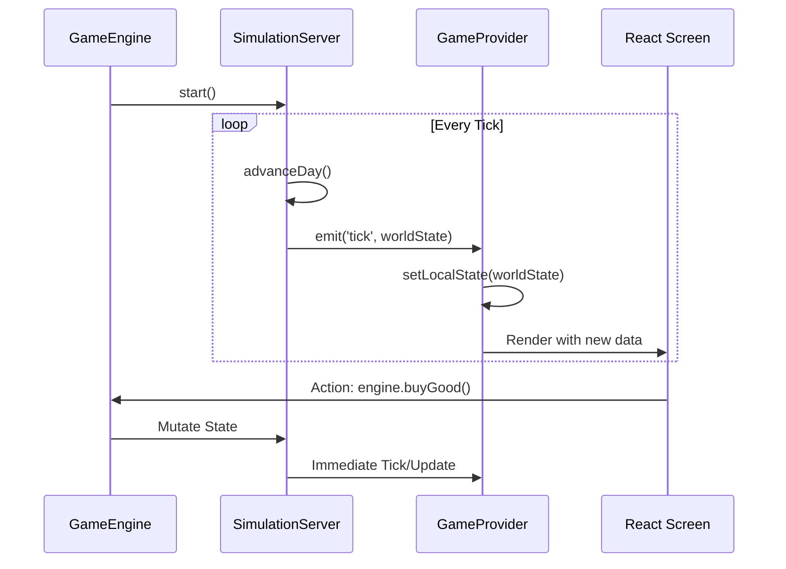

# ENGINE-UI BRIDGE: GameProvider & Adapter

## 1. Overview
The bridge allows the decoupled **Simulation Engine** to communicate with the **React UI**. It ensures that UI components are reactive to game ticks while maintaining the engine as a pure logic entity.

## 2. GameProvider.tsx
A React Context Provider that wraps the entire application.

### 2.1 Responsibilities
- **Lifecycle**: Instantiates the `GameEngine` on mount.
- **Tick Sync**: Sets up an interval or listener to the `SimulationServer` event bus.
- **State Propagation**: Maps the engine's internal state to a React `useState` object, triggering re-renders across the app.

### 2.2 Key Methods
- `useGame()`: Hook to access the `engine` instance for triggering actions.
- `usePlayer()`: Hook to access reactive player data.
- `useWorld()`: Hook to access city and market data.

## 3. engineAdapter.ts
A translation layer that provides a clean, type-safe API for the UI.

### 3.1 Design Pattern: Adapter
Instead of components calling complex internal methods of the `SimulationServer`, they use the adapter's simplified methods.

| UI Call | Adapter Logic | Engine Method |
|---|---|---|
| `buyGood(id, q)` | Validate funds -> | `engine.playerBuy(id, q)` |
| `sellGood(id, q)` | Validate stock -> | `engine.playerSell(id, q)` |
| `buildShip(type)` | Check shipyard -> | `engine.buildShip(city, type)` |

## 4. Event Flow (Mermaid)

