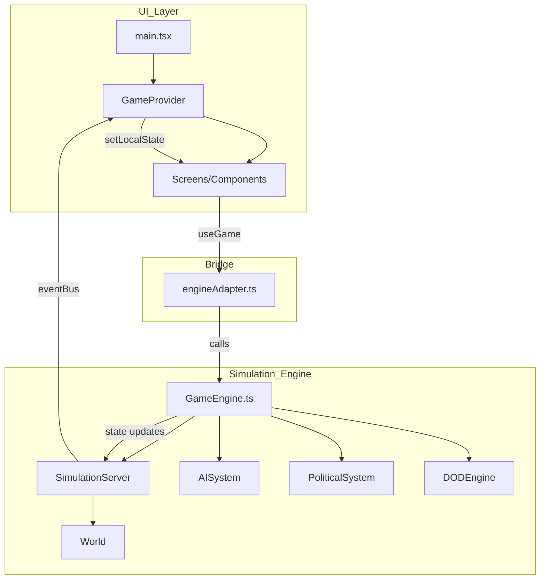

# SYSTEM DESIGN ARCHITECTURE

## 1. High-Level Flow
1. **Entry Point (`main.tsx`)**: Renders `App` wrapped in `GameProvider`.
2. **`GameProvider`**: 
   - Instantiates `GameEngine`.
   - Creates a context-bound state for React components.
   - Manages the "Tick" interval (e.g., daily simulation steps).
3. **`GameEngine`**:
   - Manages `SimulationServer`.
   - Orchestrates `AISystem`, `PoliticalSystem`, `EventSystem`, and `CombatManager`.
4. **`SimulationServer`**:
   - Holds the `World` object.
   - Emits events via `eventBus` (Tick, Day change, Encounters).
5. **UI Layer**:
   - React Screens in `src/screens` use `useGame()` to get state.
   - Triggers methods on the `engine` (e.g., `engine.playerBuy`).

## 2. Decoupling Strategy
The `GameEngine` is designed to be runnable in a **Headless** mode (Node.js) for balance testing and server-side simulation. 
- It does not depend on React or any browser APIs directly (except where Node shims are used for FS).
- State is serialized via `SaveManager`.

## 3. Data-Oriented Design (DOD)
To handle the large-scale simulation of 20+ cities and thousands of goods interactions, the engine employs a `DODEngine`.
- **Batch Processing**: Instead of processing every city-item pair as an object, it processes data in typed arrays for performance.
- **Location**: `src/sim_engine/DODEngine.ts`.

## 4. State Persistence
- **Format**: JSON.
- **Logic**: Deep serialization of the `World`, `Player`, and `AI` states.
- **Target**: Local storage or filesystem.

## 5. Diagram (Mermaid)

