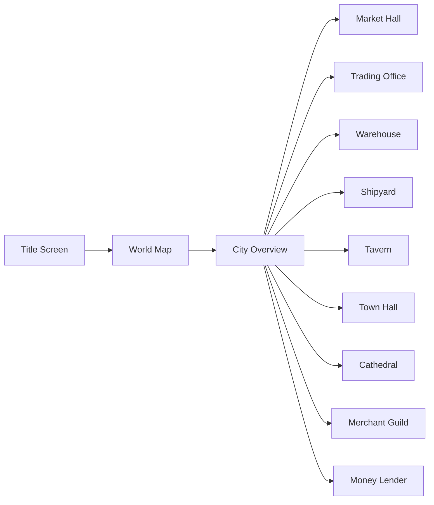

# GLOBAL SCREEN MAP

## 1. Navigation Flow
The application uses a SPA (Single Page Application) routing system (Wouter).

## 2. Screen Index
Based on forensic analysis of `src/App.tsx` and `src/screens/index.ts`.

| Screen Name | Path | Domain | Description |
|---|---|---|---|
| **Title Screen** | `/` | Meta | Main menu, load/save entry. |
| **City Overview** | `/city/:id` | World | Main view of a city, navigation to buildings. |
| **World Map** | `/world-map` | World | Hansa navigation, fleet movement. |
| **Market Hall** | `/market` | Economy | Trading goods with the city market. |
| **Trading Office** | `/office` | Economy | Player headquarters, manager hiring. |
| **Warehouse** | `/warehouse` | Economy | Stock management and auto-trade rules. |
| **Shipyard** | `/shipyard` | Naval | Building, repairing, upgrading ships. |
| **Tavern** | `/tavern` | Social | Hiring sailors, captains, missions. |
| **Town Hall** | `/townhall` | Politics | Council, elections, city tasks. |
| **Cathedral** | `/cathedral` | Social | Donations, prestige, city upgrades. |
| **Merchant Guild** | `/guild` | Politics | Rank progression, trade permits. |
| **Money Lender** | `/lender` | Economy | Taking loans, weekly payments. |
| **Financial Ledger** | `/ledger` | Player | Balance sheets and history. |
| **Council Hall** | `/council` | Politics | Voting and political strategy. |
| **Combat Arena** | `/combat` | Naval | Naval combat interface. |
| **Ship Inspection** | `/vessel` | Naval | Detailed ship status. |
| **Settings & Career Log** | `/settings` | Meta | Game options and player history. |
| **Event Overlays** | `/events` | System | Critical alerts and world events. |
| **Shipyard Tech Tree** | `/tech-tree` | Naval | Vessel and technology research. |
| **Message Center** | `/messages` | Social | Global inbox for non-critical mail. |
| **Char Creation** | `/create` | Meta | New game setup and character traits. |
| **Siege Defense** | `/siege` | War | Managing city defenses during attacks. |
| **Building Stats** | `/stats` | Economy | Productivity and ROI analysis. |
| **Bankruptcy** | `/bankruptcy`| Economy | Asset liquidation and debt crisis. |
| **Political Exile** | `/exile` | Politics | Pariah status and pardon tracking. |

## 3. Modal / Overlay System
- **Convoy Manager**: Managing ships in a convoy.
- **Trade Route Editor**: Setting up automated trading loops.
- **Alerts/Events**: Dynamic popups for world events.
- **Construction Wheel**: Interactive UI for placing buildings.

## 4. UI Diagram (Mermaid)

